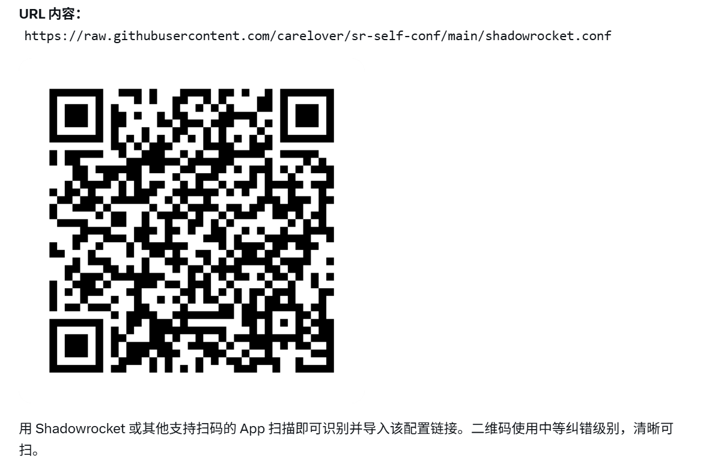

# Shadowrocket 大陆日常分流配置

国内服务直连、海外服务代理，附带秋风纯广告规则，可减少部分开屏与摇一摇广告。配置和广告规则由本仓库每周自动更新。

> 这是**分流配置**，不包含代理节点、订阅或账号。使用前请在 Shadowrocket 中准备好自己的可用节点。

## 扫码获取配置

下面二维码包含本仓库的配置文件网址。截图保留原始二维码像素，点击图片可查看原图。

[](assets/shadowrocket-config-qr.png)

1. 在电脑或另一台设备上打开此页面，使用手机扫码读取链接。也可以保存图片，使用支持从相册识别二维码的扫码工具。
2. 如果扫码后直接出现 Shadowrocket 的配置导入提示，确认下载即可。
3. 如果扫码后打开的是一页配置文本，复制网址，打开 **Shadowrocket → 配置 → 右上角「＋」**，粘贴网址并下载。
4. 下载完成后，选中该配置；返回首页，将**全局路由设为「配置」**，选择自己的节点并连接。
5. 确认广告规则集也已下载。在策略组中，`AdBlock` 选 `REJECT` 表示开启广告拦截；选 `DIRECT` 可临时关闭。

二维码编码的是普通 HTTPS 网址，并非节点二维码或专用的一键导入指令。不同扫码工具可能只显示网址，不一定自动导入 Shadowrocket。

## 手动添加

无法扫码时，复制下面的完整地址添加到 Shadowrocket 的远程配置中：

```text
https://raw.githubusercontent.com/carelover/sr-self-conf/main/shadowrocket.conf
```

[打开配置文件](https://raw.githubusercontent.com/carelover/sr-self-conf/main/shadowrocket.conf)

如果 GitHub Raw 暂时无法访问，可以先连接已有的可用代理，再下载配置。不要将本配置链接填入节点订阅地址。

## 更新与广告开关

- 仓库计划在**每周一北京时间 04:23**更新；实际执行时间可能延迟。[查看运行记录](https://github.com/carelover/sr-self-conf/actions)
- GitHub 更新不会主动推送到手机。请在 Shadowrocket 中刷新远程配置，并确认广告规则集也已更新。
- 配置内的广告规则从本仓库 `rules/ads.list` 获取。无需再重复安装同源广告模块。
- 广告拦截不需要安装 HTTPS 解密证书；它阻止广告请求，**不会禁止 App 读取运动传感器**，无法保证过滤所有 App 或已经缓存的广告。
- 如果某个应用异常，可先将 `AdBlock` 切换为 `DIRECT`，判断是否由广告规则造成。

## 自行维护

个人分流规则在 `custom.rules`，生成逻辑在 `build.mjs`。修改后由工作流重新生成配置，避免直接编辑生成后的 `shadowrocket.conf`。

当前广告规则优先于 `custom.rules`；需要放行某个被误拦截的域名时，应在生成器中将精确例外放到广告规则之前。详细说明见 [使用说明](使用说明.txt)。

## 规则来源

- 国内外分流：[blackmatrix7/ios_rule_script](https://github.com/blackmatrix7/ios_rule_script)，保留 [GPL-2.0 许可证](LICENSE)。
- 广告过滤：[TG-Twilight/AWAvenue-Ads-Rule](https://github.com/TG-Twilight/AWAvenue-Ads-Rule) 的 Only.Ads 版本，独立保存并保留 [GPL-3.0 许可证](licenses/AWAvenue-GPL-3.0.txt)。

已完成生成器与代表域名的分流检查；不同 iOS、Shadowrocket 和 App 版本的实际效果仍需在设备上验证。
